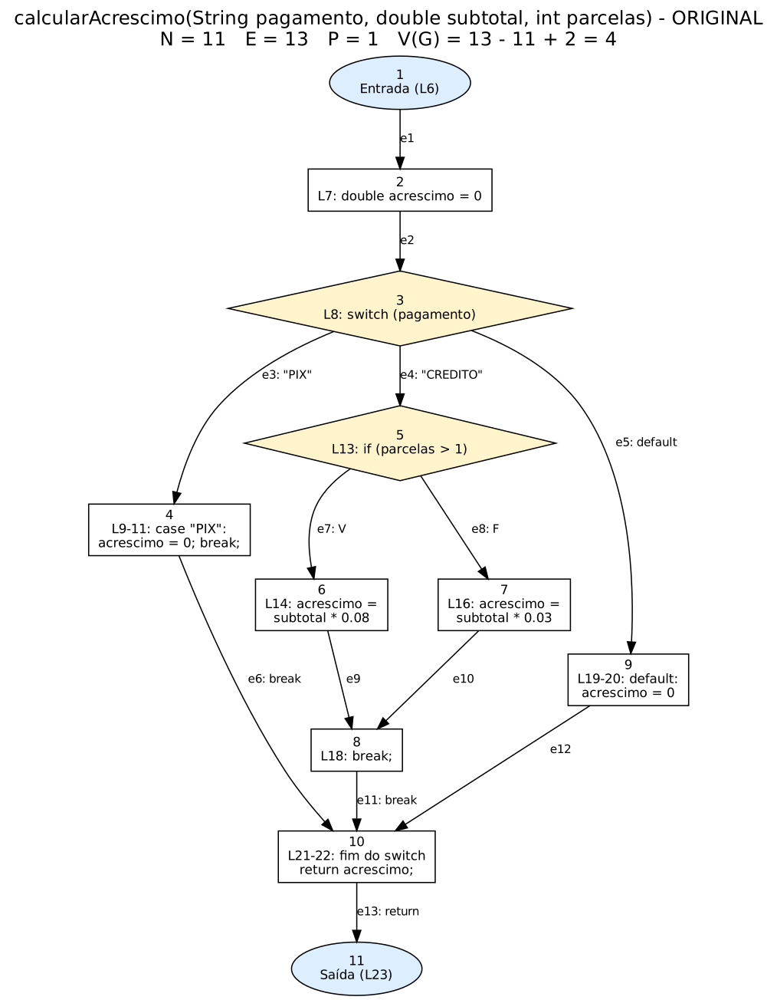
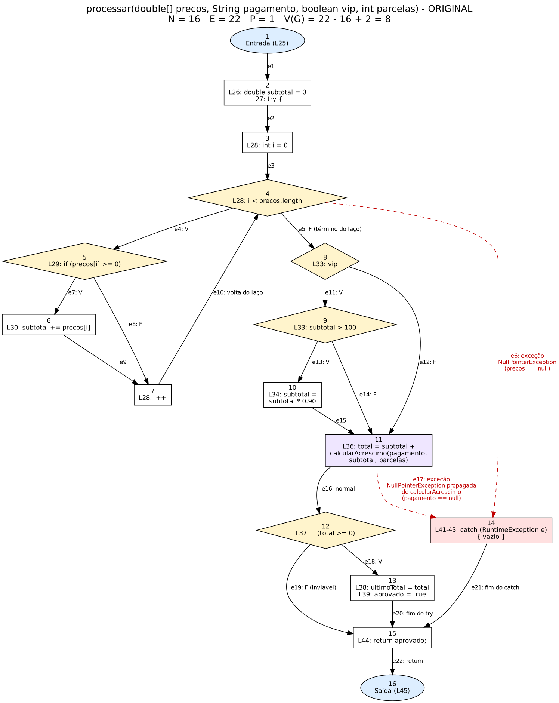

# Atividade: Teste de Caixa Branca, Cenário 3 (Processamento de Pedidos)

**Aluno:** Thalysson Sergio Fernandes Soares
**Curso:** Análise e Desenvolvimento de Sistemas, FACENS
**Cenário atribuído:** 3. Processamento de pedidos (`ProcessadorPedidos`)

## Sumário

1. [Introdução e identificação do cenário](#1-introdução-e-identificação-do-cenário)
2. [Instruções de execução](#2-instruções-de-execução)
3. [Análise estática](#3-análise-estática)
4. [Grafos de fluxo de controle e convenções](#4-grafos-de-fluxo-de-controle-e-convenções)
5. [Cálculo de V(G) por método](#5-cálculo-de-vg-por-método)
6. [Caminhos básicos](#6-caminhos-básicos)
7. [Matriz de casos de teste e resultados](#7-matriz-de-casos-de-teste-e-resultados)
8. [Correções implementadas e comparação antes/depois](#8-correções-implementadas-e-comparação-antesdepois)
9. [Limitações](#9-limitações)
10. [Conclusão e referências](#10-conclusão-e-referências)

---

## 1. Introdução e identificação do cenário

Este repositório traz a análise de caixa branca da classe Java legada `ProcessadorPedidos` (cenário 3). O trabalho cobre:

- inspeção estática do código;
- modelagem do fluxo de controle;
- cálculo da complexidade ciclomática e dos caminhos básicos independentes;
- elaboração e execução de testes;
- comparação do código original com uma versão revisada.

Conforme a regra 3.2 do enunciado, os dois métodos principais do cenário 3 são:

| Método | Linhas (original) | Grafo |
|---|---|---|
| `calcularAcrescimo(String pagamento, double subtotal, int parcelas)` | 6 a 23 | sim |
| `processar(double[] precos, String pagamento, boolean vip, int parcelas)` | 25 a 45 | sim |
| `getUltimoTotal()` | 47 a 49 | não (método `get...`) |

**Fluxo e interação entre os métodos (código original).** `processar` soma os preços do vetor e ignora os negativos (L28 a L32). Se o cliente é VIP e o subtotal passa de 100, aplica 10% de desconto (L33 a L35). Em seguida, **chama `calcularAcrescimo` com o subtotal já descontado** (L36). Esse método devolve 0 para PIX, 8% para crédito com mais de uma parcela, 3% para crédito em uma parcela e 0 para qualquer outro valor (L8 a L21). Se `total >= 0` (L37), `processar` grava `ultimoTotal` e marca `aprovado = true`. Toda `RuntimeException` do bloco `try` é capturada e descartada (L41 a L43). O método então devolve o atributo `aprovado` (L44), que nunca volta a `false`. Uma `NullPointerException` lançada em `calcularAcrescimo` (pagamento nulo) **propaga para `processar`** e cai nesse `catch`. A interação entre os dois métodos aparece no grafo de `processar` (nó 11 e aresta excepcional e17) e é testada nos casos CT13, CT15, CT18 e CT22.

**Estrutura do repositório**

```
atividade-caixa-branca/
├── original/ProcessadorPedidos.java       # código-base sem alterações
├── revisado/ProcessadorPedidos.java       # código revisado e comentado
├── testes/
│   ├── TestesProcessadorPedidos.java      # programa de testes repetível (o mesmo para as duas versões)
│   └── executar_testes.sh                 # compila e executa original e revisado, gravando as evidências
├── diagramas/
│   ├── grafo_calcularAcrescimo.dot / .png # arquivo-fonte (Graphviz) e imagem
│   ├── grafo_processar.dot / .png
│   └── verificar_grafos.py                # confere N, E, V(G), regiões e independência dos caminhos
├── evidencias/
│   ├── execucao_terminal.txt              # comandos e saída completa do terminal
│   ├── saida_testes_original.txt
│   ├── saida_testes_revisado.txt
│   └── verificacao_grafos.txt
├── PLANO_DE_TESTE.xlsx                    # modelo da disciplina; somente a aba CAIXA BRANCA (ESTÁTICO) preenchida
└── README.md                              # este relatório
```

> **Observação sobre a numeração:** a imagem do código-base fornecida começa na linha 2 (`public class ProcessadorPedidos {`). A linha 1 não aparece na imagem. Por isso ela foi mantida em branco em `original/ProcessadorPedidos.java`, para que todas as referências de linha deste relatório (L2 a L50) coincidam com a imagem do enunciado.

---

## 2. Instruções de execução

**Requisitos:** JDK 8 ou superior (`javac` e `java` no PATH). Nenhuma biblioteca externa é necessária.

As duas versões têm o mesmo nome de classe (`ProcessadorPedidos`) e a mesma API pública. Por isso, **o mesmo arquivo de testes** é compilado duas vezes, uma com cada versão, em pastas de saída separadas.

### Linux / macOS / Git Bash (script)

Na raiz do repositório:

```bash
bash testes/executar_testes.sh
```

O script compila as duas versões em `build/`, executa os testes e grava as saídas em `evidencias/saida_testes_original.txt` e `evidencias/saida_testes_revisado.txt`.

### Windows (CMD ou PowerShell) ou execução manual

Na raiz do repositório:

```
javac -encoding UTF-8 -d build/original original/ProcessadorPedidos.java testes/TestesProcessadorPedidos.java
java -Dstdout.encoding=UTF-8 -cp build/original TestesProcessadorPedidos ORIGINAL

javac -encoding UTF-8 -d build/revisado revisado/ProcessadorPedidos.java testes/TestesProcessadorPedidos.java
java -Dstdout.encoding=UTF-8 -cp build/revisado TestesProcessadorPedidos REVISADO
```

No CMD, se os acentos das mensagens aparecerem trocados, execute `chcp 65001` antes. Para salvar a saída em arquivo, acrescente `> evidencias/saida_testes_revisado.txt` ao comando `java`.

**Código de saída:** o programa termina com código 0 quando todos os casos passam e 1 quando algum falha. Na versão original, o código 1 é **esperado**, porque vários casos demonstram falhas do legado (seção 7).

### Verificação dos grafos (opcional)

```bash
pip install networkx numpy
python3 diagramas/verificar_grafos.py
# para regenerar as imagens (Graphviz):
dot -Tpng diagramas/grafo_calcularAcrescimo.dot -o diagramas/grafo_calcularAcrescimo.png
dot -Tpng diagramas/grafo_processar.dot -o diagramas/grafo_processar.png
```

### O que foi realmente executado

Tudo foi executado em Linux x86_64 com OpenJDK 21.0.13.1, Graphviz 2.43.0 e Python 3. Comandos e saídas completas estão em `evidencias/execucao_terminal.txt` e `evidencias/verificacao_grafos.txt`. Os comandos para Windows acima são os mesmos comandos `javac`/`java` do script, mas não foram executados em Windows.

---

## 3. Análise estática

A inspeção foi feita sobre o código **original**. O registro completo está na planilha **`PLANO_DE_TESTE.xlsx`** (modelo fornecido na disciplina), **somente na aba `CAIXA BRANCA (ESTÁTICO)`**. As abas INFORMATIVO, SISTEMA, ACEITAÇÃO e HEURISTICA NILSEN foram mantidas como vieram no modelo.

A aba segue o formato de checklist do modelo:

- **Cabeçalho:** projeto/sistema, revisor e data da revisão.
- **Colunas do modelo:**
  - **ID**;
  - **ITEM**, a pergunta de inspeção;
  - **STATUS** (SIM, NÃO ou NÃO SE APLICA);
  - **ARTEFATO COM ERRO**, com a localização (método, linha e trecho);
  - **CORREÇÕES A SEREM REALIZADAS**, que é a recomendação.
- **Colunas acrescentadas à direita**, para atender aos campos exigidos pelo enunciado:
  - **DESCRIÇÃO DA OCORRÊNCIA / EVIDÊNCIA**;
  - **CATEGORIA**;
  - **SEVERIDADE** e **JUSTIFICATIVA DA SEVERIDADE**;
  - **RISCO / CONSEQUÊNCIA**;
  - **REF. README**, com o código EA-xx usado neste relatório.
- **Cores**, mantendo o padrão do modelo: linha vermelha indica item com ocorrência e linha azul indica item conforme ou não aplicável.

A planilha tem 24 itens:

- as 8 perguntas originais do modelo, respondidas para este código;
- 16 perguntas acrescentadas para cobrir os temas do enunciado;
- dos 24, 18 itens têm ocorrência (EA-01 a EA-18) e 6 estão conformes ou não se aplicam: nomenclatura de arquivos e classes, laço sem condição de parada, variável não inicializada, arquitetura, recursos externos e segurança contra injeção ou exposição de dados.

Resumo das ocorrências:

| ID | Item na planilha | Local (método / linhas) | Ocorrência (resumo) | Categoria | Severidade |
|---|---|---|---|---|---|
| EA-01 | 8 | processar, L41-43 | Captura genérica e vazia: qualquer RuntimeException do bloco try (NullPointerException de precos nulo na L28 ou de pagamento nulo propagada de calcularAcrescimo na L36) é descartada sem registro, sem relançamento e sem sinalização ao chamador. | Tratamento de exceções | **Crítica** |
| EA-02 | 9 | processar / atributo aprovado, L4, 39, 44 | O atributo aprovado só recebe true e nunca volta a false. | Estado dos atributos / Falha lógica | **Crítica** |
| EA-03 | 11 | processar, L29-31 | Preços negativos são ignorados em silêncio e o pedido continua. | Validação de entrada | **Alta** |
| EA-04 | 10 | processar, L28 | precos não é validado: se for null, ocorre NullPointerException em precos.length (engolida pelo EA-01); se for vazio, o laço não executa e o pedido é aprovado com total 0, sobrescrevendo ultimoTotal. | Validação de entrada / Condição de borda | **Alta** |
| EA-05 | 5 | calcularAcrescimo, L8 | switch sobre String nula lança NullPointerException (o switch chama hashCode()); não existe validação nem mensagem explicativa. | Validação de entrada | **Média** |
| EA-06 | 12 | calcularAcrescimo, L19-20 | Qualquer forma de pagamento diferente de "PIX" e "CREDITO" (inclusive "credito" minúsculo, "" ou "BOLETO") cai no default e recebe acréscimo 0, sem aviso. | Falha lógica / Validação de entrada | **Alta** |
| EA-07 | 13 | calcularAcrescimo, L13-17 | parcelas não é validado: 0 ou valores negativos caem no else e são tratados como crédito à vista (3%). | Validação de entrada / Condição de borda | **Média** |
| EA-08 | 14 | calcularAcrescimo, L6, 14, 16 | Método público aceita subtotal negativo ou não finito e devolve acréscimo negativo ou infinito (ex.: ("CREDITO", -100.0, 1) retorna -3.0). | Validação de entrada | **Média** |
| EA-09 | 15 | processar, L37-40 | Condição sempre verdadeira: subtotal só acumula valores >= 0 (ou +Infinity), o desconto multiplica por 0.90 e o acréscimo é 0, 3% ou 8% de um valor >= 0. | Falha lógica / Redundância | **Média** |
| EA-10 | 16 | processar, L29-30, 36 | Double.POSITIVE_INFINITY passa em precos[i] >= 0 e o pedido é aprovado com total Infinity; a soma de valores finitos muito grandes também pode estourar para Infinity. | Condição de borda | **Média** |
| EA-11 | 17 | calcularAcrescimo, L7, 10, 20 | Atribuições redundantes: acrescimo já é 0 desde a L7, e os ramos PIX e default repetem o mesmo valor. | Redundância / Legibilidade | **Baixa** |
| EA-12 | 3 | calcularAcrescimo / processar, L14, 16, 33, 34 | Números mágicos: taxas, limite e fator de desconto aparecem como literais, sem nome nem explicação. | Legibilidade / Boas práticas | **Baixa** |
| EA-13 | 1 | Classe ProcessadorPedidos, L2-50 | Nenhuma documentação: não está escrito o que significa parcelas, a ordem desconto -> acréscimo, o significado do retorno de processar, o conteúdo de getUltimoTotal() ou a unidade monetária. | Documentação | **Baixa** |
| EA-14 | 18 | calcularAcrescimo, L9, 12 | Formas de pagamento como literais String, comparadas com diferenciação de maiúsculas e minúsculas e sem constantes compartilhadas com quem chama. | Boas práticas / Nomenclatura | **Baixa** |
| EA-15 | 19 | Classe ProcessadorPedidos, L3, 26, 30, 34, 36 | Valores monetários representados em double (ponto flutuante binário), sujeitos a erros de arredondamento (ex.: um pedido com precos {0.1, 0.2} gera subtotal 0.30000000000000004, e não 0.30). | Boas práticas / Precisão numérica | **Média** |
| EA-16 | 20 | processar, L25-45 | O método concentra várias responsabilidades (validar e somar itens, aplicar desconto, calcular acréscimo, aprovar e guardar estado), tem nome genérico e retorno boolean que não informa o motivo de uma recusa. | Organização / Responsabilidades | **Baixa** |
| EA-17 | 21 | Classe ProcessadorPedidos, L3-4, 38-39 | Estado mutável compartilhado sem sincronização: a mesma instância usada por várias threads pode misturar ultimoTotal e aprovado de pedidos diferentes. | Boas práticas / Concorrência | **Baixa** |
| EA-18 | 22 | processar, L33-36 | Interação entre os métodos: o acréscimo é calculado sobre o subtotal já com desconto VIP. | Documentação / Regra de negócio | **Baixa** |

**Escala de severidade.**

- **Crítica:** compromete o resultado principal (aprovação) ou esconde falhas, com impacto de negócio direto e reproduzível.
- **Alta:** produz valor ou decisão incorreta com entradas plausíveis, sem sinalizar erro.
- **Média:** produz resultado incorreto só com entradas atípicas ou extremas, ou sinaliza o erro de forma pouco clara.
- **Baixa:** não altera resultados; afeta legibilidade, manutenção ou documentação.

### 3.1 Discussão por tema

**Documentação, nomenclatura, organização, legibilidade e responsabilidades.**

- A classe não tem nenhum Javadoc ou comentário de regra (EA-13). O único comentário existente (L42) justifica uma captura vazia.
- Os nomes (`calcularAcrescimo`, `subtotal`, `parcelas`) são claros e seguem camelCase. As ressalvas são:
  - `processar`: nome genérico, que não informa o que significa o `boolean` devolvido (EA-16);
  - `aprovado`: atributo da instância, embora represente o resultado de um pedido (EA-02).
- As taxas e o limite aparecem como números mágicos (`0.08`, `0.03`, `100`, `0.90` nas L14, L16, L33, L34; EA-12).
- Há atribuições redundantes de `acrescimo = 0` (L10 e L20 repetem a L7; EA-11).
- `processar` acumula validação, soma, desconto, acréscimo, aprovação e estado (EA-16).

**Validação de entrada, estado dos atributos, condições de borda e retornos.**

- Nenhum parâmetro é validado:
  - `precos` nulo gera `NullPointerException` em `precos.length` (L28) e vazio é aprovado com total 0 (EA-04);
  - preços negativos e `NaN` são ignorados pela condição `precos[i] >= 0` (L29; EA-03);
  - `Infinity` é aceito (EA-10);
  - `pagamento` nulo gera `NullPointerException` no `switch` (L8; EA-05);
  - `pagamento` desconhecido cai no `default` com acréscimo 0 (L19 e L20; EA-06);
  - `parcelas <= 0` cai no `else` de 3% (L15 e L16; EA-07);
  - `subtotal` negativo gera acréscimo negativo (EA-08).
- Quanto ao estado, `aprovado` só recebe `true` (L39) e é devolvido na L44. Assim, o retorno de uma chamada pode vir de uma chamada anterior (EA-02).
- Bordas relevantes:
  - `subtotal > 100` (L33) é estrito, então 100,00 não recebe desconto;
  - `parcelas > 1` (L13) separa 1 parcela de 2 parcelas.
- A condição `total >= 0` (L37) é sempre verdadeira (EA-09; demonstração na seção 6.2).

**Recursos externos, fechamento de arquivos/conexões e tratamento de exceções.**

- Não se aplica a recursos externos: a classe não abre arquivos, conexões ou streams, então não há fechamento a verificar.
- O tratamento de exceções é o ponto mais grave do código. O `catch (RuntimeException e)` das L41 a L43 está vazio: descarta qualquer exceção sem registro nem relançamento (EA-01). Somado ao EA-02, isso faz um pedido com dados nulos ser **aprovado** quando a instância já aprovou um pedido antes (CT17 e CT18).

**Segurança, falhas lógicas, redundâncias e boas práticas.**

- Não há injeção, segredos nem dados sensíveis no código. O risco de segurança é de **integridade do resultado financeiro**:
  - aprovação indevida (EA-01 e EA-02);
  - cobrança menor que a devida, por erro de digitação na forma de pagamento (EA-06) ou por preço negativo ignorado (EA-03).
- Falhas lógicas: EA-02, EA-06 e EA-09.
- Redundâncias: EA-09 e EA-11.
- Boas práticas:
  - `double` para valores monetários (EA-15; ex.: `{0.1, 0.2}` soma `0.30000000000000004`);
  - formas de pagamento como literais sensíveis a maiúsculas (EA-14);
  - estado mutável sem sincronização (EA-17);
  - regra implícita de calcular o acréscimo sobre o subtotal com desconto (EA-18).

---

## 4. Grafos de fluxo de controle e convenções

Os grafos foram desenhados em **Graphviz (DOT)**. Os arquivos-fonte e as imagens estão em `diagramas/`. Os dois grafos são **planares** (sem cruzamento de arestas no desenho), o que permite contar as regiões.

### 4.1 Convenções adotadas

1. **Nós:** cada nó representa a entrada do método, a saída do método, um bloco de comandos sequenciais ou uma decisão. A numeração segue a ordem do código. Cada nó indica as linhas (`Lxx`) do código original que representa.
2. **Entrada e saída explícitas:** o nó 1 é a entrada e o último nó é a saída, ligado ao `return` por uma aresta.
3. **Laço `for` (L28):** dividido em três nós: inicialização (`int i = 0`), condição (`i < precos.length`, nó de decisão) e incremento (`i++`). A aresta F da condição representa o **término do laço**. O incremento tem uma aresta de volta para a condição.
4. **Condição composta `vip && subtotal > 100` (L33):** o operador `&&` avalia em curto-circuito, então a condição foi dividida em **dois nós de decisão** (8: `vip`; 9: `subtotal > 100`). Esta é a convenção de Pressman para condições compostas, e cada condição simples vira um nó predicado.
5. **`switch` (L8):** um único nó de decisão com **uma aresta por rótulo** (`"PIX"`, `"CREDITO"`, `default`), ou seja, *k* = 3 saídas. Não há queda (*fall-through*) entre os casos: os dois `break` (L11 e L18) aparecem como arestas para o nó de fim do `switch`/`return` (nó 10), e o `default` é o último rótulo, então segue direto para esse nó. O `break` da L18 tem nó próprio (nó 8) porque é o ponto de junção do `if/else` do crédito.
6. **`break` e `return`:** contabilizados na topologia. Os `break` são as arestas e6 e e11 de `calcularAcrescimo`. Os `return` (L22 e L44) são nós ligados à saída (arestas e13 e e22).
7. **`try/catch` (L27 a L43):** o início do `try` foi incorporado ao bloco sequencial do nó 2. O `catch` é o nó 14, e a aresta e21 representa o fim do `catch` até o `return`.
8. **Exceções modeladas (arestas tracejadas em vermelho no grafo de `processar`):**
   - **e6 (nó 4 → 14):** `NullPointerException` ao avaliar `precos.length` quando `precos == null`. Só pode ocorrer na primeira avaliação da condição do laço.
   - **e17 (nó 11 → 14):** `NullPointerException` lançada no `switch (pagamento)` de `calcularAcrescimo` quando `pagamento == null` e propagada até `processar`, onde é capturada.
9. **Exceções não modeladas, e por quê:**
   - `ArrayIndexOutOfBoundsException` em `precos[i]` é impossível, porque `i` é limitado por `precos.length` e o vetor não é reatribuído.
   - Operações aritméticas com `double` não lançam exceção.
   - `Error` (por exemplo `OutOfMemoryError`) não é `RuntimeException`, portanto não desvia para este `catch`.
   - **No grafo de `calcularAcrescimo`, a `NullPointerException` do nó 3 não foi desenhada.** O método não tem `try/catch`, então ela é uma saída anormal do método, e não um desvio para `catch`. O efeito dela está modelado no grafo de `processar` (aresta e17) e é testado no CT08 (chamada direta) e nos CT15 e CT18 (via `processar`).
10. **Contagem de arestas:** os rótulos `e1, e2, ...` no desenho são exatamente as arestas contadas. O script `diagramas/verificar_grafos.py` lê os `.dot` e confere N, E, V(G) e a planaridade (saída em `evidencias/verificacao_grafos.txt`).

### 4.2 Grafo de `calcularAcrescimo(...)`



Fonte: [`diagramas/grafo_calcularAcrescimo.dot`](diagramas/grafo_calcularAcrescimo.dot)

| Nó | Linhas | Conteúdo | Tipo |
|---|---|---|---|
| 1 | L6 | entrada do método | entrada |
| 2 | L7 | `double acrescimo = 0;` | sequencial |
| 3 | L8 | `switch (pagamento)` | decisão (3 saídas) |
| 4 | L9 a L11 | `case "PIX": acrescimo = 0; break;` | sequencial |
| 5 | L13 | `if (parcelas > 1)` | decisão |
| 6 | L14 | `acrescimo = subtotal * 0.08;` | sequencial |
| 7 | L16 | `acrescimo = subtotal * 0.03;` | sequencial |
| 8 | L18 | `break;` (junção do if/else) | sequencial |
| 9 | L19 e L20 | `default: acrescimo = 0;` | sequencial |
| 10 | L21 e L22 | fim do switch; `return acrescimo;` | sequencial |
| 11 | L23 | saída do método | saída |

| Aresta | De → Para | Condição |
|---|---|---|
| e1 | 1 → 2 | |
| e2 | 2 → 3 | |
| e3 | 3 → 4 | `pagamento` é `"PIX"` |
| e4 | 3 → 5 | `pagamento` é `"CREDITO"` |
| e5 | 3 → 9 | `default` (qualquer outra String não nula) |
| e6 | 4 → 10 | `break` |
| e7 | 5 → 6 | `parcelas > 1` verdadeiro |
| e8 | 5 → 7 | `parcelas > 1` falso |
| e9 | 6 → 8 | |
| e10 | 7 → 8 | |
| e11 | 8 → 10 | `break` |
| e12 | 9 → 10 | fim do `switch` |
| e13 | 10 → 11 | `return` |

### 4.3 Grafo de `processar(...)`



Fonte: [`diagramas/grafo_processar.dot`](diagramas/grafo_processar.dot)

| Nó | Linhas | Conteúdo | Tipo |
|---|---|---|---|
| 1 | L25 | entrada do método | entrada |
| 2 | L26 e L27 | `double subtotal = 0;` e início do `try` | sequencial |
| 3 | L28 | `int i = 0` | sequencial |
| 4 | L28 | `i < precos.length` | decisão (V, F, exceção) |
| 5 | L29 | `if (precos[i] >= 0)` | decisão |
| 6 | L30 | `subtotal += precos[i];` | sequencial |
| 7 | L28 | `i++` | sequencial |
| 8 | L33 | `vip` | decisão |
| 9 | L33 | `subtotal > 100` | decisão |
| 10 | L34 | `subtotal = subtotal * 0.90;` | sequencial |
| 11 | L36 | `total = subtotal + calcularAcrescimo(...)` | chamada (normal ou exceção) |
| 12 | L37 | `if (total >= 0)` | decisão |
| 13 | L38 e L39 | `ultimoTotal = total; aprovado = true;` | sequencial |
| 14 | L41 a L43 | `catch (RuntimeException e) { }` (vazio) | tratador de exceção |
| 15 | L44 | `return aprovado;` | sequencial |
| 16 | L45 | saída do método | saída |

| Aresta | De → Para | Condição |
|---|---|---|
| e1 | 1 → 2 | |
| e2 | 2 → 3 | |
| e3 | 3 → 4 | |
| e4 | 4 → 5 | `i < precos.length` verdadeiro |
| e5 | 4 → 8 | `i < precos.length` falso (término do laço) |
| e6 | 4 → 14 | **exceção:** `NullPointerException` (`precos == null`) |
| e7 | 5 → 6 | `precos[i] >= 0` verdadeiro |
| e8 | 5 → 7 | `precos[i] >= 0` falso (negativo ou NaN) |
| e9 | 6 → 7 | |
| e10 | 7 → 4 | volta do laço |
| e11 | 8 → 9 | `vip` verdadeiro |
| e12 | 8 → 11 | `vip` falso |
| e13 | 9 → 10 | `subtotal > 100` verdadeiro |
| e14 | 9 → 11 | `subtotal > 100` falso |
| e15 | 10 → 11 | |
| e16 | 11 → 12 | retorno normal de `calcularAcrescimo` |
| e17 | 11 → 14 | **exceção:** `NullPointerException` propagada de `calcularAcrescimo` (`pagamento == null`) |
| e18 | 12 → 13 | `total >= 0` verdadeiro |
| e19 | 12 → 15 | `total >= 0` falso (**inviável**, seção 6.2) |
| e20 | 13 → 15 | fim do `try` |
| e21 | 14 → 15 | fim do `catch` |
| e22 | 15 → 16 | `return` |

---

## 5. Cálculo de V(G) por método

Fórmula: **V(G) = E − N + 2P**, com P = 1 (cada grafo de método tem um único componente conectado).

| Método | N | E | P | V(G) = E − N + 2P |
|---|---|---|---|---|
| `calcularAcrescimo` | 11 | 13 | 1 | 13 − 11 + 2 = **4** |
| `processar` | 16 | 22 | 1 | 22 − 16 + 2 = **8** |

### 5.1 Verificação de `calcularAcrescimo` (V(G) = 4)

**Pelas decisões** (V(G) = soma de (saídas − 1) dos nós de decisão + 1):

- nó 3, `switch` com 3 saídas: 3 − 1 = **2**. Convenção: um `switch` com *k* rótulos, contando o `default`, equivale a *k* − 1 decisões binárias;
- nó 5, `if (parcelas > 1)`: **1**;
- total: 2 + 1 + 1 = **4** ✔

**Pelas regiões** (grafo planar: regiões = E − N + 2 = 4):

| Região | Delimitada por |
|---|---|
| R1 | ramo PIX (3→4→10) e ramo CREDITO (3→5→…→8→10) |
| R2 | 5→6→8 e 5→7→8 (if/else do crédito) |
| R3 | ramo CREDITO (3→5→…→10) e ramo default (3→9→10) |
| R4 | região externa |

Total: **4 regiões** ✔

### 5.2 Verificação de `processar` (V(G) = 8)

**Pelas decisões:**

| Nó | Decisão | Saídas | Contribuição |
|---|---|---|---|
| 4 | `i < precos.length` (com desvio excepcional e6) | 3 (V, F, exceção) | 2 |
| 5 | `precos[i] >= 0` | 2 | 1 |
| 8 | `vip` | 2 | 1 |
| 9 | `subtotal > 100` | 2 | 1 |
| 11 | chamada a `calcularAcrescimo` (com desvio excepcional e17) | 2 (normal, exceção) | 1 |
| 12 | `total >= 0` | 2 | 1 |
| | **Soma + 1** | | 7 + 1 = **8** ✔ |

**Convenção para os fluxos excepcionais:** cada aresta excepcional modelada (e6 e e17) é uma saída a mais do nó de onde parte e soma 1 à complexidade. Isso equivale a dizer que há 5 decisões explícitas (`for`, `if` da L29, `vip`, `subtotal > 100`, `if` da L37), o que dá 5 + 1 = 6, mais 2 desvios excepcionais, totalizando **8**. Se a condição composta da L33 fosse modelada como um único nó, V(G) seria 7. Se, além disso, as exceções não fossem modeladas, V(G) seria 6. Os valores adotados (8 e 4) correspondem exatamente aos grafos desenhados.

**Pelas regiões** (grafo planar: regiões = E − N + 2 = 8):

| Região | Delimitada por |
|---|---|
| R1 | 5→6→7 e 5→7 (if dentro do laço) |
| R2 | ciclo do laço 4→5→…→7→4 |
| R3 | 8→9→11 e 8→11 (`vip` falso) |
| R4 | 9→10→11 e 9→11 (`subtotal > 100` falso) |
| R5 | 12→13→15 e 12→15 (`total >= 0`) |
| R6 | 11→12→…→15 e 11→14→15 (exceção na chamada, e17) |
| R7 | 4→8→…→11→14 e 4→14 (exceção no laço, e6) |
| R8 | região externa |

Total: **8 regiões** ✔

Conferência automática em `evidencias/verificacao_grafos.txt`: N, E, V(G), soma das decisões e planaridade dos dois grafos batem com os valores acima.

---

## 6. Caminhos básicos

Os conjuntos foram montados pelo **método da linha de base** de McCabe: escolhe-se um caminho típico como base e, a cada novo caminho, inverte-se o resultado de uma decisão. O número de caminhos de cada conjunto é igual a V(G). Para comprovar a **independência linear**, o script `verificar_grafos.py` monta a matriz caminho × aresta e calcula o posto: **4** para `calcularAcrescimo` e **8** para `processar`, iguais a V(G). Este não é o conjunto de todos os caminhos possíveis: com o laço, `processar` tem infinitos caminhos (uma variação para cada número de iterações). O conjunto básico usa no máximo uma iteração por caminho.

### 6.1 `calcularAcrescimo` (V(G) = 4)

| Caminho | Nós percorridos | Condição de execução | Viável? | Testes |
|---|---|---|---|---|
| C1 | 1-2-3-4-10-11 | `pagamento` = `"PIX"` | sim | CT01 |
| C2 (base) | 1-2-3-5-6-8-10-11 | `pagamento` = `"CREDITO"` e `parcelas > 1` | sim | CT02, CT13 |
| C3 | 1-2-3-5-7-8-10-11 | `pagamento` = `"CREDITO"` e `parcelas <= 1` | sim | CT03, CT06, CT07, CT21, CT22, CT24 |
| C4 | 1-2-3-9-10-11 | `pagamento` não nulo e diferente de `"PIX"`/`"CREDITO"` | sim | CT04, CT05 |

Fora do conjunto básico: `pagamento == null` provoca `NullPointerException` no nó 3, uma saída anormal não desenhada (seção 4.1, item 9). Esse caso é coberto por CT08, CT15 e CT18.

### 6.2 `processar` (V(G) = 8)

| Caminho | Nós percorridos | Decisão invertida em relação à base | Condição de execução | Viável? | Testes |
|---|---|---|---|---|---|
| B1 (base) | 1-2-3-4-5-6-7-4-8-11-12-13-15-16 | n/a | 1 preço ≥ 0; `vip = false`; `pagamento` válido (não nulo) | sim | CT09, CT20, CT22 |
| B2 | 1-2-3-4-8-11-12-13-15-16 | nó 4: F na 1ª avaliação (laço não executa) | `precos` vazio | sim | CT10 |
| B3 | 1-2-3-4-5-7-4-8-11-12-13-15-16 | nó 5: F | 1 preço negativo (ou NaN) | sim | CT11 |
| B4 | 1-2-3-4-5-6-7-4-8-9-11-12-13-15-16 | nó 8: V; nó 9: F | `vip = true` e subtotal ≤ 100 | sim | CT12 |
| B5 | 1-2-3-4-5-6-7-4-8-9-10-11-12-13-15-16 | nó 9: V | `vip = true` e subtotal > 100 | sim | CT13, CT14 |
| B6 | 1-2-3-4-5-6-7-4-8-11-14-15-16 | nó 11: exceção (e17) | `pagamento == null` | sim | CT15, CT18 |
| B7 | 1-2-3-4-5-6-7-4-8-11-12-15-16 | nó 12: F (e19) | `total < 0` | **não** | nenhum (inviável) |
| B8 | 1-2-3-4-14-15-16 | nó 4: exceção (e6) | `precos == null` | sim | CT16, CT17 |

Os testes CT19, CT21 e CT23 usam duas iterações do laço: CT19 combina as arestas de B1 e B3, e CT21 e CT23 repetem a iteração de B1.

**Por que B7 é inviável.**

1. `subtotal` começa em 0 e só recebe `precos[i]` quando `precos[i] >= 0` (L29 e L30). Logo, subtotal ≥ 0 (o caso `+Infinity` também é ≥ 0, e `NaN` nunca é somado, porque `NaN >= 0` é falso).
2. O desconto (L34) multiplica por 0,90, o que mantém subtotal ≥ 0.
3. `calcularAcrescimo` devolve 0, `subtotal * 0.08` ou `subtotal * 0.03`, todos ≥ 0 para subtotal ≥ 0.
4. Portanto `total = subtotal + acrescimo >= 0` **sempre**, e a aresta e19 nunca é percorrida por nenhuma entrada.

O caminho continua no conjunto básico porque pertence à topologia do grafo. A inviabilidade dele é, por si só, um achado da análise (EA-09).

**Dependência do estado da instância.** Nos caminhos excepcionais B6 e B8, o valor devolvido depende do histórico do objeto: `false` em um objeto novo (CT15, CT16) e `true` se o objeto já aprovou um pedido (CT17, CT18). Por isso esses caminhos foram testados com as duas pré-condições.

---

## 7. Matriz de casos de teste e resultados

### 7.1 Oráculo de teste (critério do resultado esperado)

O enunciado não traz uma especificação formal, então cada caso tem **um único resultado esperado**, definido pelas regras abaixo. O mesmo programa de testes é executado contra as duas versões.

**Regras extraídas do próprio código original:**

- **R1:** PIX tem acréscimo 0.
- **R2:** CREDITO tem acréscimo de 8% se `parcelas > 1` e de 3% se `parcelas == 1`.
- **R3:** cliente VIP com subtotal **estritamente** maior que 100 recebe desconto de 10%. O desconto é aplicado antes do acréscimo, que incide sobre o subtotal com desconto.

**Regras de correção derivadas da análise estática (seção 3):**

- **R4:** o pedido precisa ter ao menos um item. `precos` nulo ou vazio é inválido.
- **R5:** cada preço deve ser finito e ≥ 0, e a soma dos preços também deve ser finita. O preço 0 é válido.
- **R6:** a forma de pagamento deve ser exatamente `"PIX"` ou `"CREDITO"`. Nula ou qualquer outra é inválida.
- **R7:** no crédito, `parcelas >= 1`. O `subtotal` recebido por `calcularAcrescimo` deve ser finito e ≥ 0.
- **R8:** entrada inválida deve ser **sinalizada ao chamador por exceção**. Não pode virar retorno silencioso (`false` ou `true`).
- **R9:** o resultado de uma chamada depende só dela. Quando uma chamada falha, `getUltimoTotal()` mantém o total do último pedido aprovado.

### 7.2 Matriz

Em "Pré-condição", "novo" significa um objeto recém-criado (`new ProcessadorPedidos()`). "Histórico" significa que o mesmo objeto já processou `([50.0], "PIX", false, 1)` com aprovação. "Exceção" abrevia "lança exceção". "IAE" é `IllegalArgumentException` e "NPE" é `NullPointerException`. "total" é o valor de `getUltimoTotal()` após a chamada.

| ID | Método | Caminho(s) | Entrada | Pré-condição | Resultado esperado | Observado: original | Situação original | Observado: revisado | Situação revisado |
|---|---|---|---|---|---|---|---|---|---|
| CT01 | calcularAcrescimo | C1 | `("PIX", 200.0, 1)` | novo | retorna 0.0 (R1) | 0.0 | PASSOU | 0.0 | PASSOU |
| CT02 | calcularAcrescimo | C2 | `("CREDITO", 200.0, 2)` | novo | retorna 16.0 (R2; limite: 2 parcelas) | 16.0 | PASSOU | 16.0 | PASSOU |
| CT03 | calcularAcrescimo | C3 | `("CREDITO", 200.0, 1)` | novo | retorna 6.0 (R2; limite: 1 parcela) | 6.0 | PASSOU | 6.0 | PASSOU |
| CT04 | calcularAcrescimo | C4 | `("BOLETO", 200.0, 1)` | novo | exceção (R6) | retornou 0.0 | **FALHOU** | IAE "Forma de pagamento não suportada: BOLETO" | PASSOU |
| CT05 | calcularAcrescimo | C4 | `("credito", 200.0, 3)` | novo | exceção (R6; erro de digitação) | retornou 0.0 | **FALHOU** | IAE "Forma de pagamento não suportada: credito" | PASSOU |
| CT06 | calcularAcrescimo | C3 | `("CREDITO", 200.0, 0)` | novo | exceção (R7; parcelas inválidas) | retornou 6.0 | **FALHOU** | IAE "Quantidade de parcelas inválida: 0" | PASSOU |
| CT07 | calcularAcrescimo | C3 | `("CREDITO", -100.0, 1)` | novo | exceção (R7; subtotal negativo) | retornou -3.0 | **FALHOU** | IAE "Subtotal inválido: -100.0" | PASSOU |
| CT08 | calcularAcrescimo | exceção no nó 3 | `(null, 200.0, 1)` | novo | exceção (R6/R8) | NPE (sem mensagem própria) | PASSOU | IAE "Forma de pagamento não informada." | PASSOU |
| CT09 | processar | B1 + C1 | `([50.0], "PIX", false, 1)` | novo | true; total 50.0 | true; 50.0 | PASSOU | true; 50.0 | PASSOU |
| CT10 | processar | B2 + C1 | `([], "PIX", false, 1)` | novo | exceção (R4); total 0.0 | true; 0.0 | **FALHOU** | IAE "O pedido deve conter ao menos um item."; 0.0 | PASSOU |
| CT11 | processar | B3 + C1 | `([-10.0], "PIX", false, 1)` | novo | exceção (R5); total 0.0 | true; 0.0 | **FALHOU** | IAE "Preço inválido na posição 0: -10.0"; 0.0 | PASSOU |
| CT12 | processar | B4 + C1 | `([100.0], "PIX", true, 1)` | novo | true; total 100.0 (R3; limite: 100 sem desconto) | true; 100.0 | PASSOU | true; 100.0 | PASSOU |
| CT13 | processar | B5 + C2 | `([200.0], "CREDITO", true, 2)` | novo | true; total 194.4 (R3: 180.0 + 8% de 180.0) | true; 194.4 | PASSOU | true; 194.4 | PASSOU |
| CT14 | processar | B5 + C1 | `([100.01], "PIX", true, 1)` | novo | true; total 90.009 (R3; limite: logo acima de 100) | true; 90.009 | PASSOU | true; 90.009 | PASSOU |
| CT15 | processar | B6 | `([50.0], null, false, 1)` | novo | exceção (R8); total 0.0 | false; 0.0 (erro silenciado) | **FALHOU** | IAE "Forma de pagamento não informada."; 0.0 | PASSOU |
| CT16 | processar | B8 | `(null, "PIX", false, 1)` | novo | exceção (R4/R8); total 0.0 | false; 0.0 (erro silenciado) | **FALHOU** | IAE "O pedido deve conter ao menos um item."; 0.0 | PASSOU |
| CT17 | processar | B8 (após B1) | `(null, "PIX", false, 1)` | histórico | exceção (R8/R9); total continua 50.0 | **true**; 50.0 (aprovação herdada) | **FALHOU** | IAE; 50.0 | PASSOU |
| CT18 | processar | B6 (após B1) | `([80.0], null, false, 1)` | histórico | exceção (R8/R9); total continua 50.0 | **true**; 50.0 (aprovação herdada) | **FALHOU** | IAE; 50.0 | PASSOU |
| CT19 | processar | B1 + B3 (2 iterações) | `([10.0, NaN], "PIX", false, 1)` | novo | exceção (R5); total 0.0 | true; 10.0 | **FALHOU** | IAE "Preço inválido na posição 1: NaN"; 0.0 | PASSOU |
| CT20 | processar | B1 + C1 | `([Infinity], "PIX", false, 1)` | novo | exceção (R5); total 0.0 | true; Infinity | **FALHOU** | IAE "Preço inválido na posição 0: Infinity"; 0.0 | PASSOU |
| CT21 | processar | B1 (2 iterações) + C3 | `([0.0, 50.0], "CREDITO", false, 1)` | novo | true; total 51.5 (R5: preço 0 é válido; R2: 3%) | true; 51.5 | PASSOU | true; 51.5 | PASSOU |
| CT22 | processar | B1 + C3 | `([50.0], "CREDITO", false, 0)` | novo | exceção (R7); total 0.0 | true; 51.5 | **FALHOU** | IAE "Quantidade de parcelas inválida: 0"; 0.0 | PASSOU |
| CT23 | processar | B1 (2 iterações) + C1 | `([Double.MAX_VALUE, Double.MAX_VALUE], "PIX", false, 1)` | novo | exceção (R5; soma estoura para infinito); total 0.0 | true; Infinity | **FALHOU** | IAE "A soma dos preços excede o limite representável."; 0.0 | PASSOU |
| CT24 | calcularAcrescimo | C3 | `("CREDITO", Infinity, 1)` | novo | exceção (R7; subtotal não finito) | retornou Infinity | **FALHOU** | IAE "Subtotal inválido: Infinity" | PASSOU |

**Evidência de cada caso:** o bloco `[CTxx]` em `evidencias/saida_testes_original.txt` e em `evidencias/saida_testes_revisado.txt`. A execução completa, com os comandos, está em `evidencias/execucao_terminal.txt`. Para reproduzir, use o comando da seção 2.

**Classificação dos casos:**

| Tipo | Casos |
|---|---|
| Normais | CT01, CT02, CT03, CT09, CT13 |
| Limites | CT02/CT03 (parcelas 2 e 1), CT12/CT14 (subtotal 100 e 100,01), CT21 (preço 0), CT23 (soma acima do maior `double`), CT24 (subtotal infinito) |
| Erros e entradas inválidas | CT04 a CT08, CT10, CT11, CT15 a CT20, CT22 a CT24 |
| Estado e interação entre métodos | CT13 (acréscimo sobre subtotal com desconto), CT17 e CT18 (aprovação herdada), CT15 e CT18 (exceção propagada de `calcularAcrescimo`), CT22 (parcelas inválidas via `processar`) |

### 7.3 Resumo dos resultados

| Versão | Casos | Passou | Falhou |
|---|---|---|---|
| Original | 24 | 9 | 15 |
| Revisado | 24 | 24 | 0 |

As 15 falhas do original são **falhas do legado demonstradas por teste**, e cada uma corresponde a um achado da análise estática:

| Achado | Testes que demonstram |
|---|---|
| EA-01 e EA-02 | CT15, CT16, CT17, CT18 |
| EA-03 | CT11, CT19 |
| EA-04 | CT10, CT16 |
| EA-06 | CT04, CT05 |
| EA-07 | CT06, CT22 |
| EA-08 | CT07, CT24 |
| EA-10 | CT20, CT23 |

**Cobertura de caminhos básicos no original:** C1 a C4 e B1 a B6 e B8 foram executados. B7 é inviável (seção 6.2).

### 7.4 Caminhos dependentes de condições difíceis de induzir e uso de test doubles

- **B7 (`total < 0`) não pode ser induzido** com a classe real. Para exercitar a aresta e19, seria preciso um *stub* de `calcularAcrescimo`: uma subclasse de teste que sobrescreve o método (ele é público e não `final`) e devolve um acréscimo negativo. Isso exercitaria a topologia, mas não um cenário real. Por isso, a recomendação adotada foi remover a condição (EA-09), e não forçá-la.
- **Caminhos excepcionais (B6, B8 e e17)** foram induzidos aqui com entradas nulas. Outras `RuntimeException` vindas de `calcularAcrescimo` (por exemplo, se o cálculo passasse a consultar uma tabela de taxas externa) só seriam reproduzíveis com um *stub* que lança a exceção desejada, ou com um *mock* do componente externo injetado na classe.
- **Dependência do estado da instância (EA-02):** para reproduzir a aprovação herdada, é preciso preparar o objeto com um pedido aprovado antes do caso de teste (*fixture*). Foi o que se fez em CT17 e CT18.
- **Concorrência (EA-17):** a mistura de estado entre threads depende de escalonamento e não é determinística. A estratégia adequada seria um teste de estresse com várias threads (`ExecutorService` e `CountDownLatch` para disparar as chamadas ao mesmo tempo) ou uma ferramenta específica, como o jcstress. Esse teste não foi implementado (seção 9).
- **`Error` da JVM (por exemplo `OutOfMemoryError`)** não é induzível de forma controlada em teste unitário e também não é capturado pelo `catch (RuntimeException e)`.
- **Recursos externos:** a classe não usa banco, arquivo ou rede, então não foram necessários *mocks* de infraestrutura.

---

## 8. Correções implementadas e comparação antes/depois

O código original está **intacto** em `original/`. A versão revisada está em `revisado/ProcessadorPedidos.java`, com Javadoc e comentários `EA-xx` que ligam cada mudança ao achado correspondente. A **API pública foi mantida**: mesmas assinaturas de `calcularAcrescimo`, `processar` e `getUltimoTotal`.

### 8.1 Correções

| Achado | Correção na versão revisada | Testes que comprovam |
|---|---|---|
| EA-01 (crítica) | `try/catch` vazio removido. Entradas inválidas geram `IllegalArgumentException` com mensagem, que chega ao chamador. Nenhuma captura vazia. | CT15, CT16 |
| EA-02 (crítica) | Atributo `aprovado` removido. O retorno depende só da chamada atual. `ultimoTotal` só é atualizado depois de todas as validações. | CT17, CT18 |
| EA-03 / EA-10 | `somarPrecos` rejeita preço negativo, NaN ou infinito (indicando a posição) e soma não finita (estouro). | CT11, CT19, CT20, CT23 |
| EA-04 | `precos` nulo ou vazio é rejeitado. | CT10, CT16 |
| EA-05 | `pagamento` nulo é rejeitado com mensagem clara. | CT08, CT15 |
| EA-06 | O `default` lança exceção para forma não suportada. | CT04, CT05 |
| EA-07 | `parcelas < 1` é rejeitado no crédito. | CT06, CT22 |
| EA-08 | `subtotal` negativo ou não finito é rejeitado em `calcularAcrescimo`. | CT07, CT24 |
| EA-09 | Condição `total >= 0`, sempre verdadeira, removida. | justificativa na seção 6.2 |
| EA-11 / EA-12 / EA-14 | Retorno direto em cada ramo; constantes `TAXA_CREDITO_PARCELADO`, `TAXA_CREDITO_A_VISTA`, `FATOR_DESCONTO_VIP`, `LIMITE_DESCONTO_VIP`, `PAGAMENTO_PIX`, `PAGAMENTO_CREDITO`. | regressão: CT01 a CT03, CT09, CT12 a CT14, CT21 |
| EA-13 / EA-16 / EA-18 | Javadoc na classe e nos métodos (inclusive a ordem desconto → acréscimo). Validação e soma extraídas para `somarPrecos`. Significado do retorno documentado. | n/a (documentação) |
| EA-15 / EA-17 | **Não alterados** (seção 9). | n/a |

**Decisões de projeto justificadas:**

- **Exceção, e não `false`, para entrada inválida.** Um `false` silencioso esconderia o motivo da recusa, que é o mesmo problema do EA-01. `IllegalArgumentException` informa o motivo e obriga o chamador a tratar o erro.
- **Retorno `boolean` mantido.** Foi mantido para não quebrar quem já chama `processar`. Na versão revisada, `true` significa pedido aprovado, e um pedido inválido nunca devolve um valor: lança exceção.
- **Formas de pagamento diferentes de PIX e CREDITO passam a ser rejeitadas.** O código original atribuía acréscimo 0 a qualquer outro valor, o que faz um erro de digitação ("credito") eliminar o acréscimo do crédito. Se existirem outras formas legítimas sem acréscimo, basta incluí-las explicitamente no `switch`.
- **Regras de negócio preservadas:** taxas de 8% e 3%, desconto de 10% acima de 100 (estrito) e acréscimo sobre o subtotal com desconto (CT12, CT13 e CT14 passam nas duas versões).

### 8.2 Comparação original × revisado

| Aspecto | Original | Revisado |
|---|---|---|
| Segurança (integridade do resultado) | Aprova pedido não processado (CT17, CT18); cobra menos com forma de pagamento digitada errado (CT05) ou preço negativo (CT11) | Nenhum pedido inválido é aprovado; valores inválidos são rejeitados |
| Confiabilidade | Resultado depende do histórico da instância; aceita vazio, NaN, Infinity e parcelas ≤ 0 | Resultado depende só da chamada; estado atualizado de forma atômica (só após validar) |
| Tratamento de erros | `catch` genérico vazio; erros invisíveis | Sem capturas vazias; `IllegalArgumentException` com mensagem descritiva |
| Legibilidade | Números mágicos, atribuições redundantes, sem documentação | Constantes nomeadas, retorno direto, Javadoc, método auxiliar com responsabilidade única |
| Resultado dos testes | 9/24 | 24/24 |

### 8.3 Mudança na complexidade ciclomática

A versão revisada foi medida pela contagem de decisões (V(G) = condições simples + 1, com o `switch` de *k* rótulos contando *k* − 1). As convenções são as mesmas do original: condição composta dividida em condições simples e cada `throw` ligado à saída do método.

| Método | Decisões na versão revisada (linhas do arquivo revisado) | V(G) original | V(G) revisado |
|---|---|---|---|
| `calcularAcrescimo` | `!Double.isFinite(subtotal)` e `subtotal < 0` (L65); `pagamento == null` (L69); `switch` com 3 rótulos (L72) = 2; `parcelas < 1` (L78); `parcelas > 1` (L81) → 7 | 4 | **8** |
| `processar` | `vip` e `subtotal > LIMITE_DESCONTO_VIP` (L109) → 2. Sem `try/catch`, logo sem desvios excepcionais | 8 | **3** |
| `somarPrecos` (novo, privado) | `precos == null` e `precos.length == 0` (L130); `for` (L134); `!Double.isFinite(preco)` e `preco < 0` (L137); `!Double.isFinite(soma)` (L143) → 6 | n/a | **7** |
| **Total da lógica** | | **12** | **18** |

**Análise:**

- A complexidade total **aumentou** (12 → 18), porque cada validação explícita acrescenta uma decisão.
- `processar` ficou bem mais simples (8 → 3): a validação foi para `somarPrecos`, e os dois desvios excepcionais para o `catch` deixaram de existir.
- O aumento de V(G) é o custo das validações que corrigem os achados de maior risco. Como o enunciado admite, a qualidade melhorou sem redução de V(G).
- Na versão revisada, o número de casos de teste necessários cresce na mesma proporção. Os 24 casos executados exercitam os dois resultados (verdadeiro e falso) de todas as decisões acrescentadas, inclusive o estouro da soma (`!Double.isFinite(soma)`, L143, no CT23) e o subtotal não finito (`!Double.isFinite(subtotal)`, L65, no CT24).

---

## 9. Limitações

1. **Linha 1 do código-base:** não aparece na imagem fornecida e foi mantida em branco apenas para preservar a numeração (seção 1).
2. **Oráculo parcialmente derivado:** as regras R4 a R9 vêm da análise estática, porque o enunciado não traz especificação formal. Em especial, a rejeição de formas de pagamento além de PIX e CREDITO (R6) é uma decisão de projeto, justificada na seção 8.1.
3. **Caminho B7 inviável:** não foi executado. A inviabilidade foi demonstrada analiticamente (seção 6.2).
4. **Valores em `double` (EA-15):** mantidos na versão revisada para preservar a API pública. A troca por `BigDecimal` exigiria mudar as assinaturas e definir uma regra de arredondamento que o enunciado não especifica.
5. **Concorrência (EA-17):** a classe continua não *thread-safe*. A limitação está documentada, mas não foi implementado teste multithread.
6. **Ferramentas:** os testes são um programa Java próprio e repetível, sem JUnit, para não depender de bibliotecas externas. A cobertura de caminhos foi rastreada manualmente (tabelas das seções 6 e 7), sem ferramenta de cobertura como o JaCoCo.
7. **Ambiente:** a execução registrada foi feita em Linux com OpenJDK 21. Os comandos para Windows não foram executados neste ambiente.

---

## 10. Conclusão e referências

### Conclusão

A análise de caixa branca de `ProcessadorPedidos` chegou aos seguintes resultados:

- **Complexidade:** V(G) = 4 para `calcularAcrescimo` e V(G) = 8 para `processar`, confirmados por três formas de cálculo (fórmula, decisões e regiões).
- **Caminhos:** o conjunto de 8 caminhos básicos de `processar` revelou um caminho inviável (B7). Isso mostra que a verificação `total >= 0` não protege nada.
- **Defeitos:** os testes demonstraram 15 falhas no código original. As mais graves são a captura vazia de exceções (EA-01) combinada com o atributo `aprovado`, que nunca é reiniciado (EA-02). Juntas, elas fazem a classe **aprovar pedidos que nem foram processados** quando a instância já aprovou um pedido antes.
- **Versão revisada:**
  - valida todas as entradas;
  - sinaliza erros com exceções descritivas;
  - elimina o estado obsoleto;
  - preserva as regras de negócio originais;
  - passa nos 24 casos.
- **Complexidade da versão revisada:** a complexidade total aumentou (12 → 18) por causa das validações, enquanto `processar` ficou mais simples (8 → 3).

### Referências

- McCABE, T. J. A Complexity Measure. *IEEE Transactions on Software Engineering*, v. SE-2, n. 4, p. 308-320, 1976.
- WATSON, A. H.; McCABE, T. J. *Structured Testing: A Testing Methodology Using the Cyclomatic Complexity Metric*. NIST Special Publication 500-235. Gaithersburg: NIST, 1996.
- PRESSMAN, R. S.; MAXIM, B. R. *Engenharia de Software: uma abordagem profissional*. 8. ed. Porto Alegre: AMGH, 2016. (Teste de caminho básico, grafos de fluxo e condições compostas.)
- ORACLE. *The Java Language Specification, Java SE 21 Edition*, §14.11 (The switch Statement): um `switch` sobre `String` nula lança `NullPointerException`.
- ORACLE. *Java SE 21 API: `java.lang.Double#isFinite(double)`*.
- GRAPHVIZ. *DOT Language*. Disponível em: https://graphviz.org/doc/info/lang.html.
